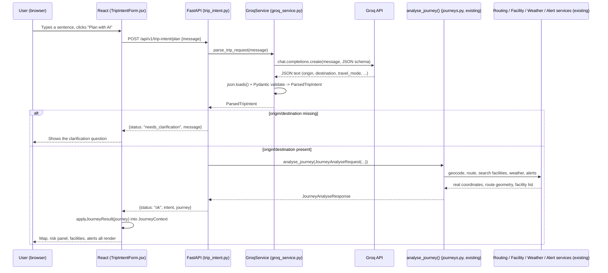

# Groq Integration Guide — AI Trip Planning

This document explains the natural-language trip-planning feature added to
RouteVision-Wayfinder: what it does, how it works end to end, which files
changed and why, and how to run and test it. It's written so you can explain
every part of it to your teacher without reading the whole codebase first.

---

## 1. What is Groq, and why does this project use it?

[Groq](https://console.groq.com/docs/overview) is a company that runs large
language models (LLMs) — like Llama or GPT-OSS — on its own custom hardware
("LPUs"), making text generation very fast. You talk to it over a normal
HTTPS API, the same shape as OpenAI's API, using their Python SDK (`groq`).

This project does **not** use Groq to plan routes, know real place
coordinates, or know what hospitals exist. It can't — it's a language model,
not a maps database, and it would be unsafe to trust it for that (it could
"hallucinate" a hospital that doesn't exist). Instead, Groq is used for
exactly one narrow job: **reading a sentence and extracting structured
fields from it.**

Example:

> "Plan a trip from Delhi to Shimla. Prefer a reasonably short and easy
> route. Show hospitals and pharmacies along the way."

becomes:

```json
{
  "origin": "Delhi",
  "destination": "Shimla",
  "travel_mode": "driving",
  "priorities": ["shorter_travel_time", "easier_route"],
  "facilities": ["hospital", "pharmacy"],
  "needs_clarification": false,
  "clarification_message": null
}
```

Everything after that point — geocoding "Delhi" and "Shimla" into real
coordinates, computing an actual route, and finding real hospitals/pharmacies
— is done by the backend's **existing** `RoutingService` and
`FacilityService`, exactly as it already did for the manual form. Groq never
touches that data.

---

## 2. How a request travels: React → FastAPI → Groq → back



Step by step, with the actual file each step lives in:

1. **`frontend/src/components/journey/TripIntentForm.jsx`** — a textarea and
   a button. On submit, it calls `planTripFromText()`.
2. **`frontend/src/lib/api.js`** (`planTripFromText`) — a small wrapper
   around `fetch`, following the exact same pattern as every other function
   in this file (`analyseJourney`, `compareRoutes`, etc.). It POSTs
   `{ message }` to `/api/v1/trip-intent/plan`.
3. **`backend/app/api/routes/trip_intent.py`** (`plan_trip_from_text`) — the
   new FastAPI endpoint. It calls `GroqService.parse_trip_request()`.
4. **`backend/app/services/groq_service.py`** (`GroqService`) — calls the
   Groq API with the user's sentence and a JSON Schema describing exactly
   the fields we want back. Groq returns JSON text; this module parses and
   **validates** it with Pydantic before trusting it.
5. Back in `trip_intent.py`: if `origin`/`destination` are missing, the
   endpoint returns a clarification question immediately — **it never calls
   the routing/facility services with incomplete data.**
6. If both are present, the endpoint builds a `JourneyAnalyseRequest` (the
   same request shape the manual form already sends) and calls
   **`analyse_journey()`** — the existing function in
   `backend/app/api/routes/journeys.py` that already powers
   `POST /journeys/analyse`. This is called directly as a normal Python
   function, not duplicated or reimplemented.
7. `analyse_journey()` does what it has always done: geocode via Nominatim,
   route via ISRO Bhuvan/OSRM, search facilities via Overpass, get weather
   via Open-Meteo, check alerts via NASA EONET/FIRMS, and run the rule-based
   risk engine. None of that code was touched.
8. The response (`TripIntentPlanResponse`, containing the same
   `JourneyAnalyseResponse` shape as the manual form) goes back to React.
9. **`frontend/src/context/JourneyContext.jsx`** (`applyJourneyResult`) puts
   that journey into the same React state `runAnalysis()` (the manual
   form's submit handler) would have set. Every existing display component —
   the Leaflet map, `RiskPanel`, `FacilityList`, `AlertsList`,
   `WeatherSamples`, `ElevationProfile` — renders it exactly as it would a
   journey planned through the form, because as far as those components are
   concerned, it's the identical data shape.

---

## 3. What JSON does the model return, and why is it validated?

Groq is asked to return **only** these seven fields (see
`backend/app/schemas/trip_intent.py: ParsedTripIntent`):

| Field | Type | Meaning |
|---|---|---|
| `origin` | string or null | Starting place, as written by the user |
| `destination` | string or null | Destination, as written by the user |
| `travel_mode` | one of `driving`/`two-wheeler`/`cycling`/`transit` | Reuses the app's existing `TravelMode` type |
| `priorities` | list of `shorter_travel_time`/`easier_route`/`avoid_highways` | What the user asked to prioritize (informational — see §9) |
| `facilities` | list of `hospital`/`fuel`/`restaurant`/`rest_stop`/`pharmacy`/`lodging` | Reuses the app's existing `FacilityCategory` type |
| `needs_clarification` | boolean | True if origin/destination couldn't be determined |
| `clarification_message` | string or null | The question to show the user, if so |

Notice `travel_mode` and `facilities` reuse the **exact same** fixed
vocabularies (`Literal` types) that `backend/app/schemas/journey.py` and
`backend/app/schemas/facility.py` already define for the manual form. This
means the model is constrained to values the rest of the app already
understands — it can't invent a new travel mode or facility category that
nothing downstream knows how to handle.

### Why validate it at all, if we gave Groq a schema?

Two layers of defense, not one:

1. **Groq's own enforcement.** With the default model
   (`openai/gpt-oss-20b`), this project uses Groq's **strict JSON Schema
   structured outputs**
   ([docs](https://console.groq.com/docs/structured-outputs)) — Groq
   constrains the model's token generation so the output is *guaranteed* to
   match the schema, no retries needed.
2. **Our own Pydantic validation, always, regardless.** The returned text is
   still run through `json.loads()` and `ParsedTripIntent.model_validate()`
   in `groq_service.py`. This matters because:
   - Not every Groq model supports strict mode (see §6's note on
     `GROQ_MODEL`) — if someone changes the configured model to one that
     doesn't, the code automatically falls back to Groq's basic "JSON
     Object Mode" (valid JSON syntax, but *not* schema-guaranteed), and the
     manual validation is what catches anything that doesn't match.
   - It's simply bad practice to trust *any* external response — model
     output, API response, or otherwise — without validating it server-side
     before acting on it.

If the JSON is malformed or doesn't match the schema, `GroqService` raises
`ServiceResponseError` (the same exception class `RoutingService` and
`FacilityService` already use for "provider responded but the response was
unusable"), and `trip_intent.py` turns that into
`{"status": "error", "message": "..."}` — never a crash, never a 500.

---

## 4. How the backend invokes the existing routing/facility services

This is the part most worth explaining carefully, because it's also the
part that keeps this feature "small": **`trip_intent.py` does not contain
any routing, geocoding, or facility-search logic.** It only:

```python
journey_request = JourneyAnalyseRequest(
    origin=intent.origin,
    destination=intent.destination,
    travel_mode=intent.travel_mode,
    include_facilities=True,
    include_alerts=True,
    facility_categories=intent.facilities or list(DEFAULT_FACILITY_CATEGORIES),
)

journey = await analyse_journey(
    journey_request,
    routing=routing,
    facility_service=facility_service,
    weather_service=weather_service,
    alert_service=alert_service,
)
```

`analyse_journey` is imported directly from
`backend/app/api/routes/journeys.py` — it's the same function FastAPI calls
for `POST /journeys/analyse`. Calling it directly like this (instead of
making an internal HTTP request to itself, which would be wasteful and
unusual) is a normal, supported pattern: a FastAPI route function decorated
with `@router.post(...)` is still just a regular Python `async def`
function underneath. The `routing`/`facility_service`/`weather_service`/
`alert_service` arguments are instances of the exact same service classes
`journeys.py` already depends on (via FastAPI's dependency injection,
`app/api/deps.py`).

The consequence: **everything `analyse_journey()` already guarantees still
applies here**, unchanged — honest `data_status` reporting, `null` instead
of fabricated values when a provider fails, the real rule-based risk engine,
route-corridor-aware facility search, and so on.

---

## 5. Files created or modified, and why

### New files

| File | Purpose |
|---|---|
| `backend/app/services/groq_service.py` | Calls the Groq API, builds the JSON Schema/prompt, validates the response, translates Groq SDK errors into the app's existing exception types. |
| `backend/app/schemas/trip_intent.py` | Pydantic models: `TripIntentRequest` (the `{message}` the frontend sends), `ParsedTripIntent` (what Groq must return), `TripIntentPlanResponse` (what the endpoint returns). |
| `backend/app/api/routes/trip_intent.py` | The new `POST /api/v1/trip-intent/plan` endpoint. Calls `GroqService`, then calls the existing `analyse_journey()`. |
| `backend/tests/test_trip_intent.py` | 12 tests for the new endpoint (see §8). |
| `backend/.env.example` | **Did not exist before** (the README and `Makefile` referenced it, but it was missing from the project — a pre-existing bug). Documents every backend environment variable, including the three new `GROQ_*` ones, with no real secrets. |
| `frontend/.env.example` | Same situation on the frontend side — created with placeholder values. |
| `frontend/src/components/journey/TripIntentForm.jsx` | The textarea + button UI component. |
| `docs/GROQ_INTEGRATION_GUIDE.md` | This document. |

### Modified files

| File | Change |
|---|---|
| `backend/app/core/config.py` | Added `GROQ_API_KEY`, `GROQ_MODEL`, `GROQ_REQUEST_TIMEOUT_SECONDS` settings and a `groq_configured` property, following the exact pattern already used for `ALERT_PROVIDER_URL`/`ISRO_BHUVAN_TOKEN`. |
| `backend/app/api/deps.py` | Added `get_groq_service()`, a FastAPI dependency provider, matching `get_routing_service()` etc. (Also removed two pre-existing unused-variable lint warnings while in this file — see §9.) |
| `backend/app/main.py` | Registered the new router: `app.include_router(trip_intent.router, prefix=API_PREFIX)`. |
| `backend/app/services/exceptions.py` | Added `"invalid_credentials"` to the existing `UnavailableReason` type, so an invalid Groq API key can be reported precisely (not just lumped in with "unreachable"). Purely additive — does not change any existing behavior. |
| `backend/requirements.txt` | Added `groq==1.7.0` (the official Python SDK). |
| `backend/.env` | Appended the three `GROQ_*` variables (blank by default — see §6). |
| `frontend/src/lib/api.js` | Added `planTripFromText()`, following the same `request()`-wrapper pattern as every other function in the file. |
| `frontend/src/context/JourneyContext.jsx` | Added `applyJourneyResult()`, which lets the new form adopt a journey into the same state `runAnalysis()` already manages — so every existing display component "just works" for AI-planned journeys too. |
| `frontend/src/pages/TripPlannerPage.jsx` | Mounted `<TripIntentForm />` above the existing form. No existing markup was changed. |
| `backend/tests/test_routing_throttle.py` | Fixed a pre-existing test-fragility bug — see §9. |
| `backend/tests/test_geocode_facility_candidates.py` | Removed one pre-existing unused import (lint warning) — see §9. |

**Nothing in `app/services/routing.py`, `app/services/facilities.py`,
`app/services/weather.py`, `app/services/alerts.py`, `app/engine/risk_engine.py`,
or any existing frontend map/display component was modified.**

---

## 6. Environment variables and the API key

Three new variables, all in `backend/.env` (never in `frontend/.env` — the
key must never reach the browser):

```bash
GROQ_API_KEY=                        # your key from console.groq.com/keys
GROQ_MODEL=openai/gpt-oss-20b        # see note below
GROQ_REQUEST_TIMEOUT_SECONDS=15
```

**To get a key:** create a free account at <https://console.groq.com>,
then create a key at <https://console.groq.com/keys>.

**If `GROQ_API_KEY` is left blank**, the feature does not crash the app — it
behaves exactly like every other optional provider in this project (NASA
FIRMS, ISRO Bhuvan): the endpoint responds with
`{"status": "error", "message": "...not set up on this server..."}`, and the
rest of the app (including the manual trip-planning form) is completely
unaffected.

**About `GROQ_MODEL`:** the default, `openai/gpt-oss-20b`, is a Groq
production model documented to support **strict** JSON Schema structured
outputs as of this writing. Groq's available models change over time (see
`backend/app/services/groq_service.py`'s `_STRICT_SCHEMA_MODELS` constant),
so if you change `GROQ_MODEL` to something outside that set, the code
automatically switches to the JSON-object-mode fallback (§3) rather than
failing — but it's worth checking
<https://console.groq.com/docs/structured-outputs> for the current list if
you do.

**Rate limits:** Groq's free tier has request-per-minute and token-per-day
limits that change over time — check your own limits at
<https://console.groq.com/settings/limits> after creating a key. A
rate-limited request from this app surfaces as
`{"status": "error", "message": "...temporarily busy..."}`, not a crash.

---

## 7. How errors are handled

Every failure mode is caught and turned into a structured response — the
endpoint **always returns HTTP 200** with a `status` field, the same
"honest `data_status`, never a surprise 500" philosophy the rest of this
API already follows for `/journeys/analyse`.

| Situation | What happens |
|---|---|
| `GROQ_API_KEY` not set | `status: "error"`, "not set up on this server" |
| Invalid/revoked API key | `status: "error"`, "misconfigured" (logged server-side as `invalid_credentials`) |
| Groq rate-limits the request | `status: "error"`, "temporarily busy" |
| Groq times out / unreachable | `status: "error"`, "temporarily unavailable" |
| Groq returns malformed JSON | `status: "error"` (caught by `json.loads()`) |
| Groq's JSON doesn't match the schema | `status: "error"` (caught by Pydantic `ValidationError`) |
| Origin and/or destination missing | `status: "needs_clarification"`, with a question to show the user |
| Everything succeeds | `status: "ok"`, with the full `journey` |
| A downstream provider (OSRM, Overpass, etc.) fails *after* Groq succeeds | Unchanged — `analyse_journey()` already reports this honestly via `data_status`, exactly as it does for the manual form |

None of this uses fragile string-matching on error messages — it uses Groq
SDK's own typed exceptions (`groq.AuthenticationError`, `groq.RateLimitError`,
`groq.APITimeoutError`, etc.), mapped to this project's existing
`ServiceUnavailableError`/`ServiceResponseError` types with an explicit
`reason`, the same convention already used throughout `routing.py`,
`facilities.py`, `weather.py`, and `alerts.py`.

---

## 8. How to run and test it locally

### Run it

```bash
cd backend
cp .env.example .env    # if you don't already have one
# edit .env: paste your key into GROQ_API_KEY=
pip install -r requirements.txt
uvicorn app.main:app --reload --port 8000
```

```bash
cd frontend
npm install
npm run dev
```

Open <http://localhost:5173/trip-planner> — the new "Plan with a sentence"
box is above the existing form.

Try it directly, without the UI:

```bash
curl -s -X POST http://localhost:8000/api/v1/trip-intent/plan \
  -H "Content-Type: application/json" \
  -d '{"message": "Plan a trip from Delhi to Shimla. Prefer a short and easy route. Show hospitals and pharmacies."}'
```

### Run the tests

```bash
cd backend && pytest -v
```

**12 new tests** in `tests/test_trip_intent.py`, **all passing**, covering:
a full happy path (verifying the journey actually came from the real
`analyse_journey()` pipeline, not a copy); missing destination →
clarification; the model forgetting to set `needs_clarification` itself
(defense in depth); malformed JSON from Groq; JSON that doesn't match the
schema; Groq timeout; invalid API key (401); rate limit (429); no
`GROQ_API_KEY` configured at all; empty facility results; the JSON-object
fallback mode for a non-strict-schema model; and request validation (blank
message rejected with 422).

**All of this is mocked** — `respx` intercepts calls to
`https://api.groq.com/openai/v1/chat/completions` (Groq's real, documented
endpoint) the same way the existing test suite already mocks Nominatim/
OSRM/Overpass/Open-Meteo. **No real API key, network access, or Groq quota
is used or required to run the tests.**

**Actual result when this was built:** `139 passed` (127 existing + 12 new;
see §9 for a pre-existing test that was fixed along the way), `ruff check`
clean, frontend `npm run build` and `npm run lint` clean, existing frontend
`npm test` (35 tests) still passing.

---

## 9. What this can — and cannot — do

**Can:**
- Turn a plain-English trip request into the same structured parameters the
  manual form sends, for English requests roughly matching the example
  patterns in this guide.
- Fall back to asking a clarifying question when origin/destination aren't
  clear.
- Recognize facility types (hospitals, pharmacies, fuel, restaurants, rest
  stops, lodging) and travel modes the user explicitly asks for.
- Degrade honestly (never crash, never fabricate data) if Groq is
  unconfigured, down, rate-limited, or returns something unusable.

**Cannot:**
- **Compare multiple routes.** If the user says "prefer the shorter route,"
  the app notes that preference in its response message, but it does not
  call the separate route-comparison pipeline to find and compare
  alternatives — `analyse_journey()` (same as the manual form) returns
  **one** route from whichever provider succeeded (ISRO Bhuvan or OSRM).
  The response never claims a route is "shorter" or "easier" than an
  alternative it didn't actually compare — this matches the project's
  existing rule that the app may only describe a route that way when the
  evidence actually supports it.
- **Verify facility operational status.** Exactly like the manual form:
  "verification_status" on a facility is about coordinate confidence only,
  never about whether it's currently open — see
  `backend/docs/API_CONTRACT.md`.
- **Handle a request in a form Groq can't parse into the fixed schema** —
  e.g., multi-leg trips ("go to Agra, then Jaipur, then back"), relative
  dates, or anything requiring information the LLM doesn't have (it is
  explicitly instructed never to invent a place or distance it isn't told).
- **Run without a Groq API key** — this specific feature only; the rest of
  the app is unaffected.
- **Do anything beyond interpretation.** It never executes code, and no
  tool-calling/function-calling is used — Groq's only output is a JSON
  object that gets validated, never executed.

### Pre-existing issues noticed and fixed along the way (not Groq-related)

While inspecting the codebase per the task's Phase A, a few small
pre-existing issues turned up. Since scope stayed within "small, safe
fixes," they were corrected:

1. **`backend/.env.example` and `frontend/.env.example` didn't exist**,
   even though `README.md` and the `Makefile`'s `make setup` both reference
   them. Both are now created (§5).
2. **`tests/test_routing_throttle.py`** had one test
   (`test_default_user_agent_is_an_unmistakable_placeholder_not_a_fake_contact`)
   that called `Settings()` with no override, which reads whatever
   `HTTP_USER_AGENT` is currently in your own `backend/.env` — meaning the
   test would fail for any developer who, correctly, followed the README's
   own instruction to replace the placeholder with a real contact address.
   Fixed by passing `_env_file=None` so the test checks the *coded default*
   specifically, independent of your local `.env`.
3. Two trivial, pre-existing `ruff` lint warnings (an unused `status`
   import in `deps.py`, an unused exception variable, and one unused import
   in a test file) were cleaned up.
4. **Security note, not a code bug:** the `backend/.env` and
   `frontend/.env` files in the uploaded project already contained
   what look like real, working API keys/tokens (a NASA FIRMS key, an ISRO
   Bhuvan token, Supabase keys, and a MapTiler key). These files are
   correctly listed in `.gitignore` so they won't be committed going
   forward, but **if this project (or the zip it came from) is ever shared
   publicly, those keys should be rotated first.** Nothing in this
   integration reads, logs, or forwards any of those values.

---

## 10. Questions a teacher might ask

**Q: Why Groq and not just calling OpenAI/another LLM provider?**
A: The task required a free/low-cost provider suitable for a student
project, with a currently-supported structured-output mode and an official
Python SDK — Groq fits that (fast inference, a free tier, and
schema-enforced JSON output) and the task specified it directly.

**Q: Where exactly does the LLM's responsibility end?**
A: At turning a sentence into `{origin, destination, travel_mode,
priorities, facilities}`. It never sees or produces coordinates, distances,
route geometry, or facility names — those come only from the existing
Nominatim/OSRM/Overpass/Open-Meteo integrations, unchanged.

**Q: What stops the model from hallucinating a fake hospital or a fake
distance?**
A: It's never asked to. The schema it must return has no field for a
facility list, a distance, or a duration — only `facilities` (a *category*
like `"hospital"`, not a name) and `travel_mode`. Even if it tried, nothing
downstream would read a facility name or distance from the LLM's output; the
Pydantic schema would reject any extra field (`additionalProperties: false`
in the JSON Schema Groq is given).

**Q: How do you know the JSON Groq returns is safe to use?**
A: Two layers: Groq's own strict JSON Schema enforcement (schema-guaranteed
output for the configured model), and a second, independent Pydantic
validation pass in `groq_service.py` regardless of which mode was used.
Nothing is ever `eval`'d, and no field value is ever used to build a file
path, SQL query, or shell command — it only becomes a
`JourneyAnalyseRequest`, the same Pydantic-validated request type the
manual form already produces.

**Q: What happens if two users send the same message at the same time, or
if Groq is slow?**
A: Each request is independent — `GroqService` is created fresh per-request
(FastAPI dependency injection, like every other service in this app) with
no shared mutable state. `GROQ_REQUEST_TIMEOUT_SECONDS` (default 15s) bounds
how long a single request can hang.

**Q: Why not let the LLM call a "search_facilities" function directly (tool
calling)?**
A: The task explicitly prohibits letting the model execute arbitrary
functions, and tool-calling adds real complexity (parsing tool-call JSON,
validating arguments, handling multi-turn tool loops) for no benefit here —
a single structured-JSON extraction call is simpler, cheaper, and easier to
make reliable and testable.

**Q: Is the API key ever exposed to the browser?**
A: No. It's read only in `backend/app/core/config.py` from the server-side
`GROQ_API_KEY` environment variable, and `GroqService` is only imported by
backend code. No frontend file references it.

**Q: What's the single biggest limitation of this feature?**
A: It cannot meaningfully act on "prefer the shorter/easier route" beyond
recording it, because the underlying routing providers (OSRM demo server /
ISRO Bhuvan) return one route per request through the pipeline this feature
reuses — true route comparison exists elsewhere in the app
(`/journeys/compare-routes`) but wiring the AI feature into it was left out
to keep this change small, as the task required.
