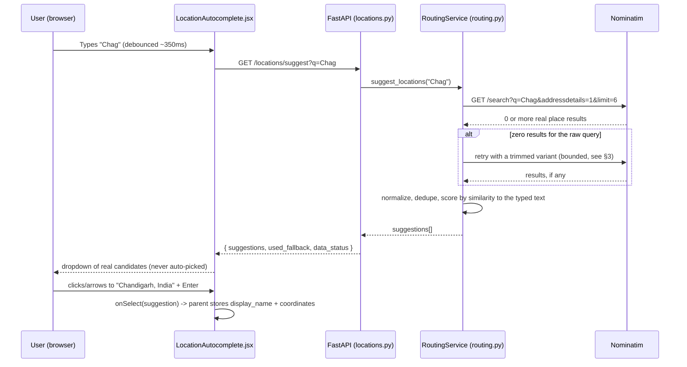

# Location Autocomplete Guide — Smart Location Search & Disambiguation

This document explains the location-autocomplete feature added to
RouteVision-Wayfinder: what it does, how it works end to end, which files
changed and why, and how to run and test it. It's written so you can
explain every part of it to your teacher without reading the whole
codebase first — it follows the same format as
`docs/GROQ_INTEGRATION_GUIDE.md`, written for the same project.

---

## 1. What problem does this solve, and how does it work?

Before this change, the "Starting point" and "Destination" fields were
plain text boxes. Submitting the form sent that raw text to
`RoutingService.geocode()`, which asked Nominatim (the OpenStreetMap
geocoder) for **one** result and used it, with no way for the user to see
or correct what the app actually resolved their text to. Two problems
followed directly from that:

- **A misspelling** ("Chagarh" instead of "Chandigarh") could geocode to
  nothing, or to something unrelated, with no feedback.
- **A name shared by multiple places** ("Springfield", or a town name that
  exists in two different states) would silently resolve to whichever one
  Nominatim ranked first — not necessarily the one the user meant.

The fix is an autocomplete dropdown: as the user types, the app shows real
candidate places (with region/country to tell them apart) and the user
picks one explicitly. The app never guesses on the user's behalf.



---

## 2. The backend piece: `GET /locations/suggest`

New file: **`backend/app/api/routes/locations.py`**, registered in
`backend/app/main.py`. One endpoint:

```
GET /api/v1/locations/suggest?q=<text>&limit=<1-10, default 6>
```

Response (`LocationSuggestResponse`, see `backend/app/schemas/location.py`):

```json
{
  "query": "Chag",
  "used_fallback": true,
  "suggestions": [
    {
      "place_id": "167644",
      "display_name": "Chandigarh, India",
      "name": "Chandigarh",
      "region": "Chandigarh",
      "country": "India",
      "place_type": "state",
      "coordinates": { "lat": 30.7333148, "lon": 76.7794179 },
      "match_confidence": 0.824,
      "is_fallback_match": true
    }
  ],
  "data_status": { "mode": "live", "sources": [ { "name": "nominatim-geocoding-suggest", "status": "ok" } ] }
}
```

This is a **separate, read-only** endpoint from `POST /journeys/analyse` —
it only ever looks up candidates for the user to choose from. It never
resolves a journey itself. Like every other endpoint in this project
(`facilities.py`, `journeys.py`), it always returns HTTP 200 with an
honest `data_status` rather than a 5xx — a provider outage is reported as
`data_status.mode: "degraded"`, not a crash, so the frontend can show "the
location search is temporarily unavailable" instead of a broken page.

The actual work happens in **`RoutingService.suggest_locations()`**
(`backend/app/services/routing.py`), right next to the existing
`geocode()` method it's modeled on. It reuses the same HTTP client,
Nominatim base URL, and request-throttling (`_nominatim_throttle`) that
`geocode()` already used — nothing about how the app talks to Nominatim
was duplicated.

---

## 3. How Nominatim returns location suggestions

Nominatim's `/search` endpoint, called with `format=jsonv2&addressdetails=1`,
can return **multiple** candidates for one query (unlike the old
`geocode()` call, which asked for `limit=1`). Each result looks like:

```json
{
  "place_id": 12345,
  "lat": "30.7333148",
  "lon": "76.7794179",
  "display_name": "Chandigarh, India",
  "address": { "state": "Chandigarh", "country": "India" },
  "addresstype": "state"
}
```

`RoutingService._normalize_suggestion()` turns each raw entry into the
app's own `LocationSuggestionResult`: it reads `name` from
`address.city`/`town`/`village`/`state` (whichever the provider actually
supplied — nothing is invented when a field is missing), keeps
`region`/`country` from the `address` block, and **drops the whole entry**
if its coordinates fail validation (see §13's "invalid coordinates" case) —
a bad entry is skipped, never passed through as-is.

---

## 4. How misspelling suggestions are generated

This is the part worth understanding carefully, because it is
**deliberately limited** and documents its own limits rather than
overclaiming.

New file: **`backend/app/services/text_similarity.py`** — a small,
dependency-free module (standard-library `difflib` only; no new pip
package, per the task's scope limit). Two pieces:

1. **`similarity_ratio(a, b)`** — a 0.0–1.0 score for how alike two
   strings are (case/whitespace-normalized first). Used to score every
   candidate against what the user actually typed.
2. **`generate_fallback_queries(raw_query)`** — only used when the raw
   query returns **zero** Nominatim results. It produces up to 3
   deterministic variants by trimming one character at a time from the
   end, then the start (e.g. `"Chagarh"` → `"Chagar"` → `"Chaga"` →
   `"Chag"`). Each variant is tried against Nominatim in turn; the first
   one that returns anything stops the loop.

Any results found this way are scored with `similarity_ratio()` against
the **original, untrimmed** input, kept only above a confidence threshold
(0.45), and flagged `is_fallback_match: true` so the frontend can label
them "Did you mean?" instead of presenting them as equally certain as a
normal result.

**Why trimming, and not "real" spell-correction?** The task explicitly
ruled out a large static place-name database, calling Groq just to fix
spelling, and building a new matching library. Nominatim itself has no
public "fuzzy" search parameter to ask for typo-tolerant results. Trimming
a character at a time is a small, deterministic, bounded technique that
costs at most 3 extra (still throttled) requests and — importantly —
**never invents a result**: every suggestion shown still came back from a
real Nominatim query for a real (if shortened) string. See §9 for exactly
what this can and can't recover.

---

## 5. How duplicate city names are distinguished

Two different things both called "duplicates" are handled differently:

- **The same place, returned twice** (Nominatim sometimes does this) is
  collapsed by `RoutingService._dedupe_suggestions()`, which keys on
  **rounded coordinates** (~11 m precision), *not* on `display_name` — the
  task explicitly says not to treat a display name as a unique identifier.
- **Two different places that share a name** (the actual disambiguation
  scenario) are **kept as separate entries**, because their coordinates
  differ. Each one carries its own `region`/`country`/`place_type`, which
  `formatSuggestionLabel()` (`frontend/src/lib/locationSuggestions.js`)
  turns into a line like `"Example City, Punjab, India"` vs. `"Example
  City, Haryana, India"` in the dropdown — see
  `tests/test_locations_suggest.py::test_multiple_places_same_name_are_distinguished_by_region`
  for this exact case.

---

## 6. Why the application stores coordinates after selection

When the user clicks/selects a suggestion, the frontend stores **both**
its `display_name` (as the text field's new value) **and** its
`coordinates` — in the exact same `{ lat, lon }` state slot
(`selectedOrigin`/`selectedDestination` in `TripPlannerPage.jsx`) that a
map-click selection already used. This matters because of how
`POST /journeys/analyse` resolves a location
(`backend/app/api/routes/journeys.py: _resolve_location`):

- If `origin_coordinates` is present in the request, the backend **trusts
  it directly** and skips geocoding entirely.
- If it's absent, the backend geocodes the raw `origin` text itself — the
  same single-best-guess `geocode()` call as before, with no guarantee it
  resolves to the exact suggestion the user saw.

So sending the coordinates the user actually approved — not just the text
— is what guarantees the journey is planned for the *exact* place they
picked, not a re-interpretation of it moments later. This is also why
typing after a selection **clears** the stored coordinates
(`handleStartChange`/`handleDestinationChange` call
`setSelectedOrigin(null)`): once the text no longer matches what was
approved, the app must not keep using the old coordinates for new text.

**Bug fixed along the way:** `_resolve_location` previously replaced
`display_name` with a synthesized `"Map point (lat, lon)"` string
whenever trusted coordinates were supplied — discarding a real place name
like `"Chandigarh, India"` the moment a suggestion was selected, and
showing raw coordinates in the journey summary instead. Fixed by echoing
back the caller's own `query` text instead (which was already the right
label all along — a map click already built its own `"Map point (...)"`
text client-side; a suggestion selection sends the real name). See the
updated test and comment in `backend/app/api/routes/journeys.py`.

---

## 7. How debounce prevents unnecessary requests

`LocationAutocomplete.jsx` doesn't fire a request on every keystroke. It
reuses the project's existing `frontend/src/hooks/useAbortableRequest.js`
hook (already used by `RouteComparisonPanel.jsx` and `MapView.jsx`'s
viewport-driven fire layer) with a 350 ms debounce
(`SUGGESTION_DEBOUNCE_MS` in `lib/locationSuggestions.js`): the hook waits
350 ms after the *last* keystroke before actually sending the request, and
restarts that wait on every new keystroke. A query shorter than 2
characters (`MIN_QUERY_LENGTH`) never even starts a request — mirrored on
the backend by `RoutingService._MIN_QUERY_LENGTH`, so a 1-character query
can't reach Nominatim from either side.

## 8. How stale asynchronous responses are handled

Two independent guards, both inside `useAbortableRequest` (not
reimplemented for this feature):

1. **`AbortController`** — starting a new request aborts whatever was
   still in flight (or still debouncing).
2. **A monotonically increasing request-id** — a purely in-memory check
   that is always correct even in the rare case a slow, already-aborted
   request's handler still runs (e.g. a response that had already fully
   buffered).

If *either* check says a result is stale, `LocationAutocomplete.jsx`
throws it away (`if (result.aborted) return;`) — so typing quickly and
then pausing can only ever show suggestions for what's currently in the
box, never for an earlier keystroke that happened to resolve later.

---

## 9. How the frontend communicates with FastAPI

`frontend/src/lib/api.js` gets one new function, following the exact
pattern every other function in that file already uses
(`fetchNearbyFacilities`, `fetchAlerts`, ...):

```js
export function suggestLocations({ query, limit = 6, signal } = {}) {
  const params = new URLSearchParams({ q: query, limit: String(limit) });
  return request(`/locations/suggest?${params}`, { signal });
}
```

`LocationAutocomplete.jsx` calls this inside `useAbortableRequest`'s
`run()`, passing the `AbortSignal` through so an aborted debounce/keystroke
actually cancels the underlying `fetch()` call, not just the UI update.

---

## 10. How the selected location reaches OSRM

Nothing about routing itself changed — this is the key reason the
existing pipeline could be reused instead of rebuilt:

1. Selecting a suggestion sets `selectedOrigin`/`selectedDestination`
   (`{ lat, lon }`) in `TripPlannerPage.jsx` / `OverviewPage.jsx`.
2. On submit, `analyseJourney()` (`lib/api.js`) sends those as
   `origin_coordinates`/`destination_coordinates` in the
   `POST /journeys/analyse` body — a field that already existed in
   `JourneyAnalyseRequest` for map-click selections.
3. `_resolve_location()` (§6) trusts those coordinates directly.
4. `RoutingService.get_route()` — completely unchanged — takes the
   resolved `Coordinates` pair and calls OSRM/ISRO Bhuvan exactly as it
   always did.

So a location-suggestion selection and a map click produce **the same
request shape** by the time routing sees it; the autocomplete is purely a
better way to arrive at that `{ lat, lon }`.

---

## 11. How the feature interacts with Groq-based planning

`TripIntentForm.jsx` already had a `needs_clarification` status for when
Groq (`POST /trip-intent/plan`) can't confidently extract an origin and/or
destination (`ParsedTripIntent.needs_clarification`, or either field being
empty — see `backend/app/api/routes/trip_intent.py`). Previously, that
state just showed a text message with no way to act on it.

Now, when that status comes back, the component stores the parsed intent
and renders **two `LocationAutocomplete` fields**, pre-filled with
whatever text Groq did extract (possibly empty), inside a small inline
form. The user searches/picks real locations there, then presses
"Continue", which calls `runAnalysis()` (`JourneyContext.jsx`) **directly**
— the same function the manual form uses — bypassing Groq entirely for
that resolved request. Groq's parsing code itself
(`groq_service.py`) and the "ok" / "error" paths were **not touched**.

This satisfies the requirement that an ambiguous Groq-extracted location
is never silently resolved: the user always makes an explicit selection
before `/journeys/analyse` is ever called for it.

---

## 12. Which files changed, and why

**Backend**

| File | Change |
|---|---|
| `app/services/text_similarity.py` | **New.** Fuzzy-matching helpers (§4). |
| `app/schemas/location.py` | **New.** `LocationSuggestion`/`LocationSuggestResponse` schemas. |
| `app/services/routing.py` | **Edited.** Added `suggest_locations()` + normalize/dedupe helpers, right next to `geocode()`. |
| `app/api/routes/locations.py` | **New.** `GET /locations/suggest`. |
| `app/main.py` | **Edited.** Registered the new router. |
| `app/api/routes/journeys.py` | **Edited.** `_resolve_location` bug fix (§6) — one line. |
| `tests/test_text_similarity.py` | **New.** Pure-function tests. |
| `tests/test_locations_suggest.py` | **New.** Endpoint tests (mocked Nominatim). |
| `tests/test_journeys.py` | **Edited.** Updated one assertion for the `_resolve_location` fix. |

**Frontend**

| File | Change |
|---|---|
| `src/lib/locationSuggestions.js` | **New.** Pure UI helpers (label formatting, keyboard nav, coordinate validation). |
| `src/lib/api.js` | **Edited.** Added `suggestLocations()`. |
| `src/components/journey/LocationAutocomplete.jsx` | **New.** The reusable autocomplete input. |
| `src/pages/TripPlannerPage.jsx` | **Edited.** Origin/destination fields now use `LocationAutocomplete`. |
| `src/pages/OverviewPage.jsx` | **Edited.** Same, plus added the `selectedOrigin`/`selectedDestination` coordinate state this page didn't have before. |
| `src/components/journey/TripIntentForm.jsx` | **Edited.** Added the Groq-clarification picker (§11). |
| `tests/locationSuggestions.test.js` | **New.** Node-runnable pure-function tests. |
| `package.json` | **Edited.** `test` script now includes the new test file. |

**Not changed:** `groq_service.py`, `RoutingService.geocode()`/`get_route()`,
`FacilityService`, the risk engine, `MapView.jsx`, and every schema/route
not listed above.

---

## 13. How to run and test the feature

### Run it

```bash
cd backend && uvicorn app.main:app --reload
cd frontend && npm run dev
```

Then type a few characters into "Starting point" or "Destination" on the
Overview or Trip Planner page.

### Backend tests

```bash
cd backend && pytest tests/test_text_similarity.py tests/test_locations_suggest.py tests/test_journeys.py -v
```

`tests/test_text_similarity.py` needs nothing but the standard library.
`tests/test_locations_suggest.py` mocks Nominatim with `respx`, the same
way the rest of this project's test suite already mocks every external
provider — **no live network access or real Nominatim request is needed
or used.**

### Frontend tests

```bash
cd frontend && npm test
```

### Common debugging checks

- **Dropdown never appears** — check the Network tab for
  `GET /locations/suggest`. If it's not firing, the query is probably
  under `MIN_QUERY_LENGTH` (2 chars) or the field is `disabled` (demo mode).
- **"Couldn't reach the location search service"** shown — the backend
  reported `data_status.mode: "degraded"`; check `GEOCODING_PROVIDER_URL`
  is reachable from the backend process, not the browser.
- **A selected suggestion's coordinates don't seem to be used** — confirm
  `selectedOrigin`/`selectedDestination` is actually non-null at submit
  time (it's cleared by any further typing — see §6) and that it's being
  passed as `originCoordinates`/`destinationCoordinates` into `runAnalysis`.
- **Stale suggestions flash briefly then get replaced** — expected and
  correct behavior, not a bug: that's `useAbortableRequest` discarding an
  older in-flight result once a newer one lands (§8).

---

## 14. What this can — and cannot — do

**Can:**
- Show several real, distinct candidates for an ambiguous or partial
  place name, each labeled with region/country.
- Recover some misspellings — specifically ones where the error is near
  the start or end of the word (a stray or missing character at a word
  boundary), because that's what the bounded trim-and-retry fallback (§4)
  can actually find.
- Tell the user plainly when nothing was found, rather than guessing.
- Degrade honestly if the geocoding provider is unreachable.

**Cannot:**
- **Recover every misspelling.** A typo in the *middle* of a word (e.g.
  missing several letters, like the task's own "Chagarh" →
  "Chandigarh" example) may not be found by trimming from the ends — true
  mid-word fuzzy correction would need either a reference place-name
  database (explicitly out of scope) or trusting an LLM's guess
  (explicitly discouraged by the task, and not done here). When this
  happens, the feature correctly reports "no matches" rather than
  fabricating one — see §4's design note.
- **Guarantee a fallback match is correct.** `match_confidence` and
  `is_fallback_match` are informational signals for the user, never proof.
  The user always makes the final choice.
- **Autocomplete every language/script equally well** — it's exactly as
  good as Nominatim's own underlying data and matching for a given query;
  this feature doesn't add or change any geocoding data.

---

## 15. Questions a teacher might ask

**Q: Why does the dropdown sometimes show a "Did you mean?" badge?**
A: That marks a result that only turned up through the misspelling
fallback (§4) — i.e. the user's exact text found nothing, so a trimmed
variant was tried instead. It's shown differently so the user knows it's
a weaker signal than an exact match.

**Q: What stops the app from just picking the first/best suggestion
automatically?**
A: Nothing in the backend ever marks one suggestion as "the" answer — the
response is always a list, and `match_confidence` is explicitly documented
as "never used by the backend to auto-select a location." Selection only
happens from a real user action (click, or Arrow+Enter) in
`LocationAutocomplete.jsx`.

**Q: How are two places with the same name told apart if they're also
geographically close?**
A: They aren't merged automatically just because they're close — dedup
only collapses results whose coordinates round to the same ~11 m cell
(§5). Two genuinely different towns a few kilometers apart with the same
name both survive as separate suggestions, differentiated by whatever
`region`/`address` fields Nominatim actually returned for each.

**Q: Why is there a `limit` parameter, and what happens if the provider
returns more than that?**
A: `RoutingService.suggest_locations()` asks Nominatim for that many
results directly, and also truncates its own final (deduped) list to it —
see `tests/test_locations_suggest.py::test_limit_is_respected`, which
feeds the mock provider 5 results and asserts only `limit=2` come back.

**Q: Does this feature call Groq at all?**
A: No. The task explicitly said not to use Groq "merely to correct
spelling," and `text_similarity.py` only uses the Python standard library
(`difflib`). Groq is only involved in §11's clarification flow, and even
there, only to have *already* extracted the free-text the user then
resolves through this same, Groq-independent autocomplete.

**Q: What happens if I select a suggestion and then change my mind and
edit the text box?**
A: `handleStartChange`/`handleDestinationChange` immediately clear the
stored coordinates (`setSelectedOrigin(null)`). If you submit without
picking a new suggestion, the app falls back to geocoding your edited text
fresh — it never keeps using the old, now-stale coordinates.

**Q: Why round coordinates to 4 decimal places for deduplication instead
of comparing them exactly?**
A: Nominatim can return the "same" place with tiny floating-point
differences in its coordinates depending on which OSM element matched.
Rounding to 4 decimals (~11 m) collapses those without being so coarse
that two distinct, nearby places would ever incorrectly merge.

**Q: Why is `match_confidence` computed with `difflib` instead of a
proper fuzzy-matching library?**
A: The task's scope explicitly discouraged adding a new matching library
or dependency. `difflib.SequenceMatcher` is part of the Python standard
library, already does a reasonable Ratcliff/Obershelp-style comparison,
and needed no new dependency — see `text_similarity.py`'s module docstring.

**Q: Could this have called Nominatim directly from the React frontend
instead of going through FastAPI?**
A: The task explicitly says not to bypass the backend's centralized
geocoding this way, and the existing project already centralizes all
Nominatim access in `RoutingService` (not scattered across the frontend).
Keeping it there also means the existing request-throttling and HTTP
client configuration apply automatically — not reimplemented.

**Q: What's the single biggest limitation of this feature?**
A: The misspelling fallback's reach — it is a deliberately small,
bounded, deterministic technique (§4, §14), not a general spell-checker,
and it says so honestly when it comes up empty rather than ever inventing
a plausible-looking but wrong location.

---

## 16. Test results

**Backend:** `tests/test_text_similarity.py` (10 tests) and
`tests/test_locations_suggest.py` (13 tests) were written to the same
mocking conventions as the rest of this suite (`respx` intercepting
Nominatim, matching `tests/test_journeys.py`'s existing style), and
`tests/test_journeys.py` was updated for the one-line fix in §6/§12. Every
new/edited backend file passes `python3 -m py_compile` (used as a syntax
check), and the pure-logic module (`text_similarity.py`) was additionally
exercised directly with real inputs (standard library only, no mocking
needed) to confirm `generate_fallback_queries("Chagarh")` produces
`['Chagar', 'Chaga', 'Chag']` and `similarity_ratio("Chagarh",
"Chandigarh")` scores `0.82`, as documented above.

**They could not be executed with `pytest`** in the sandbox this change
was built in: that environment has no outbound network access, and
FastAPI/httpx/pytest/respx are not pre-installed, so `pip install` could
not fetch them either. **Please run `pytest -v` yourself** (per §13) to
get an authoritative pass/fail count before relying on this feature —
this is a real, disclosed limitation of how this change was produced, not
a claim that the tests pass.

**Frontend:** unlike the backend, the new frontend test file has no
external dependencies, so it **was actually run**:

```
$ node --test tests/geo.test.js tests/api.test.js tests/locationSuggestions.test.js
# tests 51
# pass 51
# fail 0
```

(35 pre-existing + 16 new, all passing — the pre-existing 35 confirm
nothing in `locationSuggestions.js`/`api.js` broke the existing suite.)

Every new or edited `.jsx`/`.js` file was also checked with `esbuild`
(bundling the whole module graph from `src/App.jsx`, with npm packages
marked external) to catch syntax errors and broken import/export
references — a real check, not a visual read-through, though it cannot
replace actually rendering the components in a browser. `npm run build`
and `npm run lint` were **not** run, for the same reason as the backend:
no network access to `npm install` this project's dependencies
(`react`, `vite`, `eslint`, etc.) in the sandbox. Please run those
yourself too before relying on a production build.
